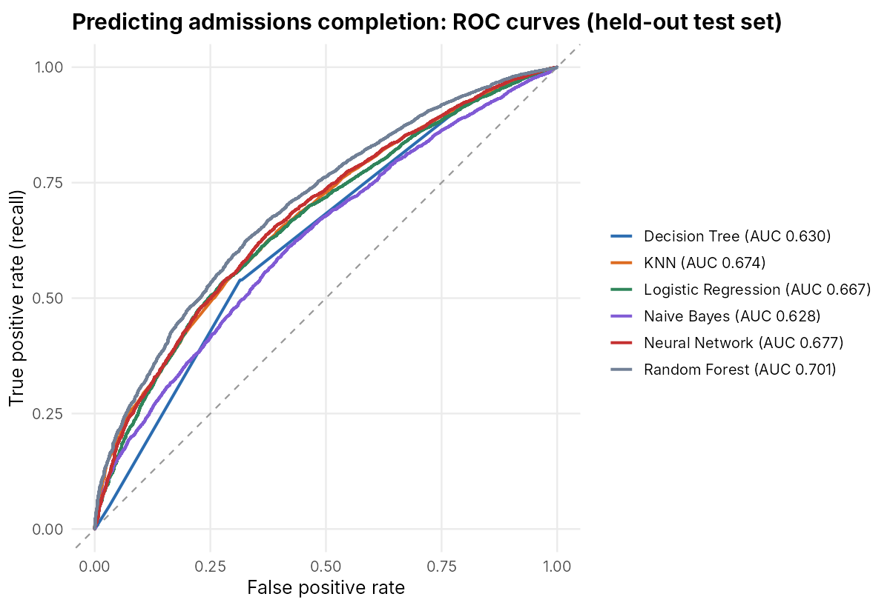
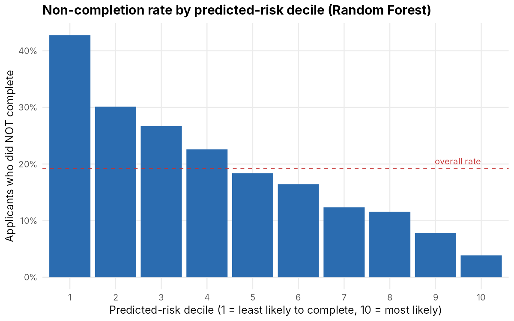
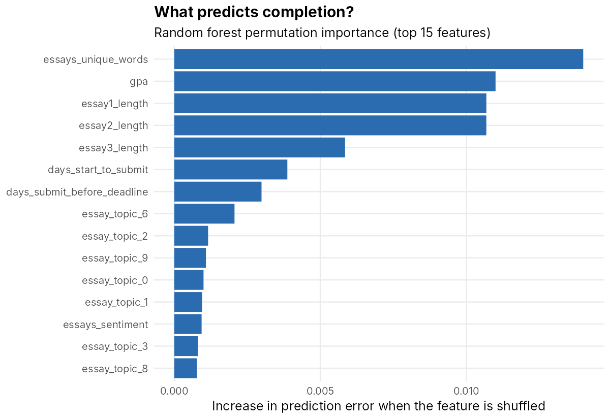
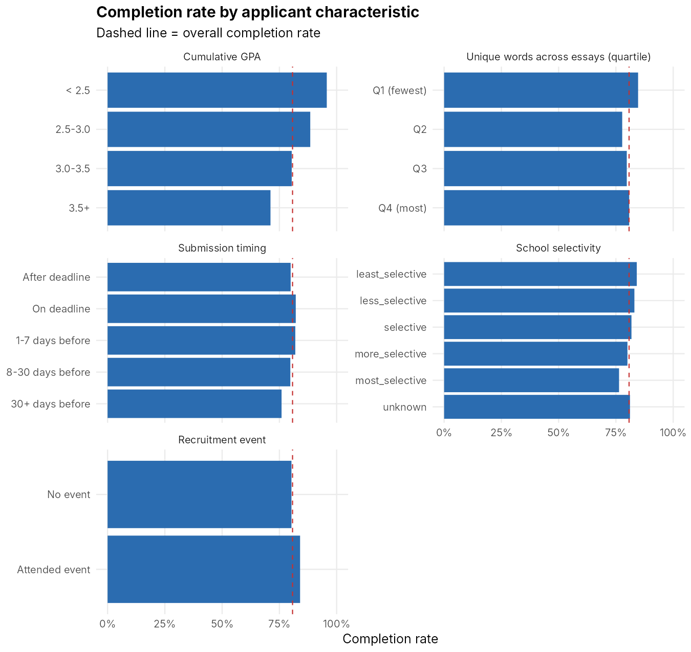

# Predicting Who Completes the Teach For America Admissions Process (R)

Of **74,839 applicants** (2015 and 2016 cohorts), **19.3% never complete the admissions process**. Can application data tell recruiters who is at risk, early enough to do something about it?

I compare six models (logistic regression, Naive Bayes, decision tree, KNN, neural network, random forest) on a held-out test set, check that the result holds when predicting a later cohort, and translate the model into something a recruiting team could act on.

Course project in the MS Marketing Analytics program at Illinois Institute of Technology, extended and re-validated for this portfolio.

## Key results

- **Completion is hard to predict from application data alone, and I say so.** The best model, a random forest, reaches **AUC 0.70** (95% CI 0.69 to 0.71). No model beats the 80.7% accuracy of always predicting "completes": at the default threshold the best reaches 80.8%.
- **It still works as a prioritization tool.** The 10% of applicants the model ranks as least likely to complete have a **42.8% non-completion rate, 2.2x the 19.3% average**. That group alone holds about 22% of all non-completers, and the riskiest 20% hold about 38%.
- **It holds up across cohorts.** Trained only on 2015 applicants and tested on 2016 applicants, AUC is **0.70** (95% CI 0.69 to 0.70) and the riskiest decile has a 42.8% non-completion rate, the same as with a random split.
- **I found and removed a leaky column.** `Confirmed TFA Offer` can only happen after completing the process: all 8,708 applicants with a confirmed offer completed. Using it as a predictor would inflate every model, so it is excluded.
- **The signal sits in the essays, GPA and application timing.** See the pattern notes below, including a counter-intuitive GPA result.

### Model comparison (held-out test set, 14,967 applicants)

Majority-class baseline accuracy: **80.7%**. Metrics other than AUC and "Accuracy at 0.5" use a decision threshold equal to the training completion rate, which flags the applicants least likely to complete.

| Model | AUC (95% CI) | Accuracy at 0.5 | Balanced accuracy | Recall: non-completers | Precision: non-completers | Non-completion in riskiest 10% | Lift |
|---|---|---|---|---|---|---|---|
| **Random forest** | **0.701** (0.691 to 0.711) | 80.7% | **0.644** | **72.1%** | 28.4% | **42.8%** | **2.22x** |
| Neural network (1 hidden layer) | 0.677 (0.667 to 0.688) | 80.4% | 0.632 | 64.7% | 28.7% | 38.4% | 1.99x |
| KNN | 0.674 (0.664 to 0.685) | 80.7% | 0.623 | 67.4% | 27.3% | 37.1% | 1.93x |
| Logistic regression | 0.667 (0.656 to 0.678) | 80.8% | 0.625 | 63.7% | 28.2% | 36.3% | 1.89x |
| Decision tree | 0.630 (0.619 to 0.641) | 80.5% | 0.611 | 68.2% | 26.1% | 36.3% | 1.89x |
| Naive Bayes | 0.628 (0.617 to 0.639) | 76.1% | 0.590 | 66.4% | 24.6% | 30.8% | 1.60x |

How to read this honestly: the random forest flags applicants who are likelier to drop out, but **only about 28% of the applicants it flags actually do**, against a 19% base rate. That is a useful ranking, not a precise prediction for any one person.

Full tables are in [`results/`](results).

## Figures

**ROC curves for all six models.**



**Non-completion rate by predicted-risk decile (random forest).** The model separates applicants well at the extremes: 43% of the riskiest decile do not complete versus under 4% of the safest.



**What the model relies on** (permutation importance: how much prediction error rises when a feature is shuffled).



**Completion rate by applicant characteristic.**



### Patterns in the data (descriptive, not causal)

- **GPA runs opposite to what many would expect:** completion is 95.7% for GPA below 2.5, 88.5% for 2.5 to 3.0, 80.4% for 3.0 to 3.5 and 71.1% for 3.5 and above. The data cannot say why. One hypothesis to test is that higher-GPA applicants have more alternatives, but that is not established here.
- **Essay features are the strongest group of predictors** (vocabulary and the three essay lengths). Applicants in the lowest quartile of unique words complete at 84.7%, against 77.8% to 80.8% in the other quartiles.
- **Timing matters a little:** applicants who submitted 30 or more days before the deadline completed at 75.9%, against about 82% for those who submitted on the deadline or in the last week.
- **School selectivity** shows a modest gradient, from 84.1% completion for the least selective schools to 76.4% for the most selective. Attending a recruitment event goes with higher completion (84.0% vs 80.3%).

## Method

1. **Target:** `Completed Admissions Process` (1 = completed). 74,839 rows, no missing values.
2. **Leakage control:** dropped `Confirmed TFA Offer` (see above) and the `Person Id` identifier. `Invited`, `Met` and `Responded` are kept, but they carry no signal (about 19% non-completion in every group).
3. **Feature engineering:** turned the date columns into timing features (days from sign-up to start, start to submission, and submission to deadline); treated a GPA of exactly 0 as "not reported" (1,212 applicants) with a flag plus median imputation from the training data; used the pre-cleaned major, minor and university columns instead of the raw high-cardinality ones.
4. **Split:** stratified 80/20 train/test split (seed 123). Imputation values and scaling use training data only.
5. **Tuning:** decision-tree complexity by 5-fold cross-validation on AUC; KNN's k and the neural network's size and weight decay on a hold-out from the training data. KNN's grid stops at k = 450 because `class::knn` fails on k = 600 with this many tied distances; validation AUC had already flattened (0.649 at k = 300, 0.652 at k = 450).
6. **Metrics:** AUC with a DeLong confidence interval, balanced accuracy, recall and precision for non-completers, and **top-decile lift**, because with an 81/19 split accuracy alone says almost nothing.
7. **Cohort check:** random forest trained on 2015 applicants only (35,774) and scored on 2016 applicants (39,065).

## Limitations and next steps

- This is observational data from two cohorts. The model ranks risk; it does not show that contacting a flagged applicant would change the outcome. That would need an experiment.
- Features such as undergraduate institution and major can correlate with protected characteristics. Any real use would need a fairness audit first.
- Next steps I would take: gradient boosting, probability calibration and a cost-based threshold (what a recruiter's time is worth versus a lost applicant), partial-dependence plots for GPA and essay length, and re-running the course's SVM and C5.0 experiments on this cleaned feature set.

## Repository structure

```
tfa-admissions-prediction/
├── data/tfa_data.csv                     # 74,839 applicants, identifiers anonymized
├── scripts/
│   ├── tfa_modeling_pipeline.R           # full verified pipeline (this README's results)
│   └── course_scripts/                   # original coursework scripts (see its README)
├── figures/                              # PNGs generated by the pipeline
└── results/                              # CSV tables generated by the pipeline
```

## How to run

Install the R packages `caret`, `e1071`, `class`, `rpart`, `nnet`, `ranger`, `pROC`, `ggplot2` and `scales`, then from the repository root:

```bash
Rscript scripts/tfa_modeling_pipeline.R
```

It takes about 10 minutes on a 2-core machine and writes everything in `figures/` and `results/`. For a quick smoke test on a sample: `TFA_SAMPLE=8000 Rscript scripts/tfa_modeling_pipeline.R`.

## Data

`data/tfa_data.csv` has 74,839 rows and 39 columns: GPA, majors and minors, school selectivity, essay length, vocabulary, topic and sentiment features, key dates, event attendance, recruiter contact flags and outcomes. Undergraduate institutions are masked (for example "school 1668", "other us university"); there are no names or contact details.

## Original coursework scripts

[`scripts/course_scripts/`](scripts/course_scripts) holds the scripts written during the course (KNN, Naive Bayes, C5.0, a `neuralnet` model and several SVM variants). They are kept for transparency, but they have known issues, including leaving `Confirmed TFA Offer` in as a predictor, and were not re-run end to end. The README in that folder lists them.
